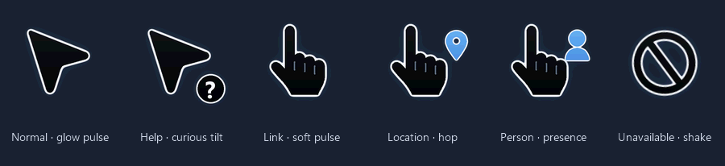
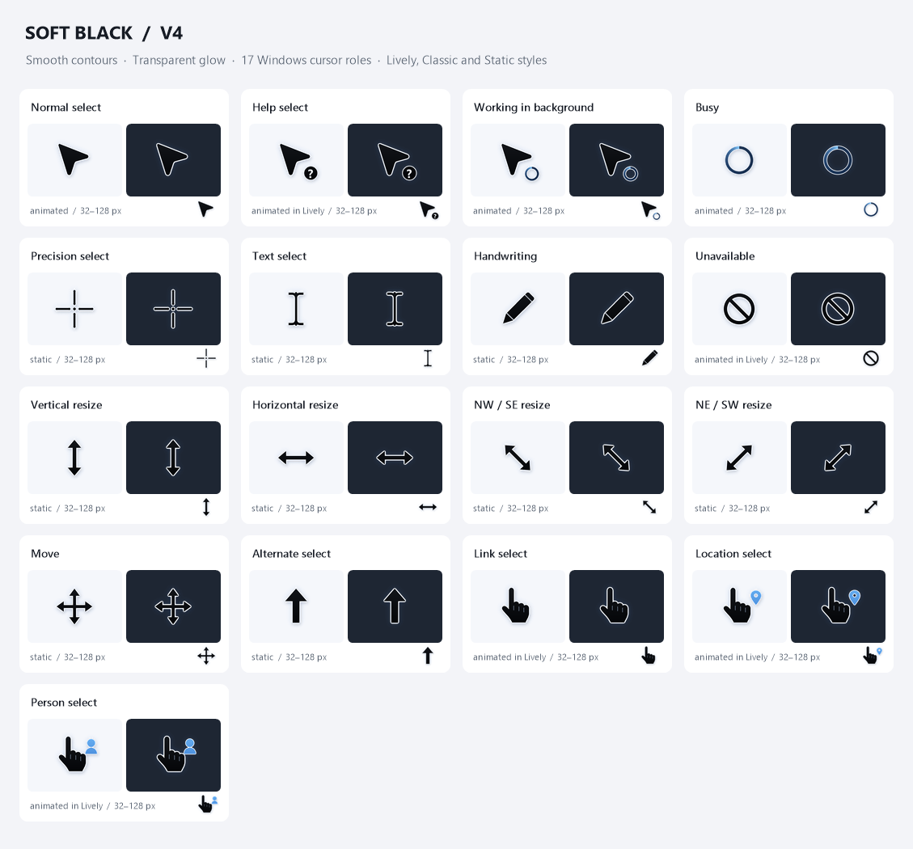

# Soft Black Arrow: permanent Windows cursor scheme

Smooth black contours, a thin white edge and a transparent blue glow, across all
17 standard Windows pointer roles, at every size from 32 to 128 px. Version 4 adds
the **Lively** style, in which eight pointers breathe, hop or shake on one shared
3.2-second rhythm. You can switch styles from the tray at any time.





**Try every pointer live:** open [`docs/index.html`](docs/index.html) (or the
project's GitHub Pages site). It has a mock Windows window where each zone shows its
pointer, plus a size, style and background switcher.

## Install

1. Download and extract the ZIP anywhere.
2. Double-click **`Install.cmd`**, or right-click `Install.ps1` and choose *Run with PowerShell*.

Administrator rights are not needed; this installs for the current user only. Your
pointer size and colour settings are kept exactly as they are.

All active cursor paths point at one permanent folder, so moving or deleting the
download afterwards changes nothing:

```
%LOCALAPPDATA%\CustomCursors\SoftBlackArrowPermanent
```

### Styles

| Style | Animated pointers | |
|---|---|---|
| **Lively** (default) | Normal, Busy, Working, Help, Link, Location, Person, Unavailable | Every loop shares the Arrow's 3.2 s glow pulse |
| **Classic** | Normal, Busy, Working | The original v3 behaviour |
| **Static** | none | No motion at all |

Pick one at install time, or change it later:

```bat
Install.cmd Classic
```

```powershell
.\Install.ps1 -Style Static
```

Or use the tray icon: **Animation > Lively / Classic / Static**. A reinstall keeps the style you chose last.

By default the scheme also honours **Settings > Accessibility > Visual effects >
Animation effects**: while that switch is off, the Static pointers are used. The
toggle *Pause when Windows animation effects are off* in the tray menu controls this.

### What the Lively animations do

| Pointer | Effect |
|---|---|
| Normal select | Soft blue glow pulse, 3.2 s (from v3) |
| Busy / Working in background | Rotating blue highlight, 1.2 s (from v3) |
| Help select | Glow pulse; the **?** badge tilts curiously at the peak |
| Link select | Glow pulse in step with the arrow |
| Location select | Glow pulse; the pin hops and lands |
| Person select | Glow pulse; the person badge lights up like a presence ping |
| Unavailable | A quick 0.6 s damped head-shake of the slash, then rest |

Precision, text, handwriting, resize, move and alternate-select pointers never animate,
because motion there would get in the way of accurate work.

## What the installer changes

- All 17 Windows cursor roles point to the files in the permanent folder.
- Windows themes are prevented from replacing the scheme (`ThemeChangesMousePointers=0`).
- Windows' built-in coloured-pointer mode is switched to the file-based scheme (`CursorType=0`).
- Your chosen cursor size and stored colour value are preserved.
- A small event-driven `CursorKeeper.exe` starts after you sign in and reapplies the
  scheme when pointer settings, display settings or the session change. It sleeps
  when idle and never polls.
- The original settings are backed up once, before the first install, to `original-state.clixml`.

Before anything is switched over, the installer copies and hash-checks every file and
asks Windows to load every pointer (`CursorKeeper.exe --check`). If any step fails,
the previous registry state is restored.

## Tray menu

| Item | |
|---|---|
| Animation | Lively / Classic / Static, and the Windows animation-effects toggle |
| Reapply cursor scheme | Force a reapply now |
| Open cursor folder | Opens the permanent folder |
| Stop protection (until next sign-in) | Exits the helper; the scheme stays applied |

Double-click the icon to see what is applied (style, size, roles).

## Stop or uninstall

- **`Stop-Protection.cmd`** stops the helper and removes its startup entry. The current
  pointers stay selected, and you can pick another scheme freely. Run `Install.cmd` to resume.
- **`Restore.cmd`** stops the helper, removes the startup entry and restores the exact saved
  pointer, theme-pointer and pointer-style settings. Your current size is kept. The backup
  and files are retained for recovery.

## Command line

```text
CursorKeeper.exe                 tray monitor (what runs at sign-in)
CursorKeeper.exe --apply         apply once and exit
CursorKeeper.exe --check         load every pointer privately, change nothing, exit 0 or 1
CursorKeeper.exe --style <name>  Lively | Classic | Static (saved; the running monitor applies it)
CursorKeeper.exe --stop          ask the running monitor to exit
```

Settings live in `keeper.ini` beside the helper:

```ini
style=Lively
followWindowsAnimations=true
```

## Limits

- This replaces the standard pointers in your signed-in Windows session. Windows'
  protected built-in files are not overwritten. The sign-in/secure desktop and
  applications or websites with their own cursor graphics can still differ.
- Windows controls startup timing, so reapplication happens after sign-in.
- Pointer sizes above 128 px are scaled from the 128 px artwork.
- A program that captures the pointer by drawing it into a surface without per-pixel
  alpha (some screen recorders do this) shows a dark halo where the soft glow is.
  Windows then draws every semi-transparent pixel as opaque. This affects any
  soft-edged cursor, and the files cannot prevent it.

## Diagnostics

- `state.json` reports the most recent application: style, size and the native roles affected.
- `keeper.log` records event-driven reapplication, checks and errors; its size is bounded.
- `validation.json` (in this repository) records the latest verification of every file. Each
  one was loaded through Windows itself at every stored size, and every animation step was
  drawn over light and dark backgrounds and compared with the source pixels.

## Building from source

Everything derived is rebuilt with the C# compiler that ships with Windows; no SDK or
package downloads are needed:

```powershell
powershell -ExecutionPolicy Bypass -File tools\Build.ps1
```

This compiles `tools\CursorForge`, which:
- regenerates the Lively animations from the static `.cur` artwork;
- compiles `CursorKeeper.exe` from [`CursorKeeper.cs`](CursorKeeper.cs);
- redraws the preview images and the `docs/` page assets;
- verifies everything and writes `validation.json`.

The build never changes your active pointers.

`tools\Serve-Docs.ps1` serves `docs/` on `http://localhost:8765/` for a local preview.

### Repository layout

| Path | |
|---|---|
| `*.cur`, `*.ani` | The 17 static pointers and 8 animated ones |
| `Install.ps1`, `Restore.ps1`, `Stop-Protection.ps1`, `Install-Static.ps1` | Scripts; the `.cmd` files are double-click launchers |
| `CursorKeeper.cs` / `.exe` | Tray helper (full source included) |
| `cursor-manifest.json` | Roles, hotspots per size, effects, styles |
| `tools/` | CursorForge generator/verifier, build script, docs server |
| `docs/` | Interactive preview page |
| `Review.md`, `CHANGELOG.md` | Design review and version history |
